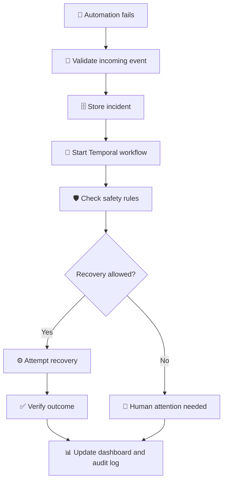

# 💜 REBOOTX — Automation Recovery Platform

### When automations break, recovery shouldn't be guesswork.

Small businesses and developers depend on automation every day. But when an API fails or a workflow stops working, fixing everything manually can take time.

**REBOOTX is an open-source, self-hosted platform that helps detect failures, manage recovery attempts, verify results, and keep a record of what happened.**

Instead of blindly retrying everything, REBOOTX combines recovery workflows, safety checks, and outcome verification to make automation failures easier to handle.

> ⚠️ **Current status:** Mock recovery is enabled by default. Real n8n recovery is optional and is still partially implemented. REBOOTX does not automatically fix every failure.

---

## ✨ What can REBOOTX do?

- 🔎 **Detect failures** — Receive alerts when an automation fails.
- 🧠 **Diagnose problems** — Use rule-based checks and AI-assisted diagnosis.
- 🔄 **Manage recovery** — Coordinate recovery steps using Temporal.
- 🛡️ **Apply safety checks** — Check permissions and rules before allowing recovery actions.
- ✅ **Verify results** — Check whether recovery worked instead of assuming it did.
- 📋 **Keep records** — Store incident details, decisions, and outcomes.
- 📊 **Monitor incidents** — View incident information and analytics on the dashboard.

## ⚙️ How does it work?



**In simple terms:** REBOOTX receives a failure event, records it, checks what is safe to do, manages the recovery process, and records the outcome.

## 🧰 Tech Stack

| Technology | Purpose |
|---|---|
| ⚛️ React + TypeScript | Dashboard and user interface |
| 🎨 Tailwind CSS + Vite | Styling and frontend development |
| 🐍 FastAPI + Python | API and failure-event processing |
| 🗄️ PostgreSQL / Neon | Data storage |
| 🔄 Temporal | Durable workflow orchestration |
| 🔗 n8n | Automation engine integration |
| 🤖 Google Gemma | AI diagnosis integration |
| 🔐 HMAC-SHA256 | Webhook authentication |
| 📈 Recharts | Dashboard analytics |
| 🐳 Docker Compose | Running services together |
| 🧱 Alembic | Database migrations |

## 🚀 Project Progress

### ✅ Checkpoint 1 — Backend Foundation
- FastAPI backend with PostgreSQL/Neon and SQLite support.
- Database migrations using Alembic.
- HMAC-SHA256 authenticated webhook ingestion.
- Audit logging.

### ✅ Checkpoint 2 — Recovery Workflows
- Temporal-based recovery orchestration.
- Transactional outbox for reliable job dispatch.
- Retry/fallback paths and duplicate-processing safeguards.

### ✅ Checkpoint 3 — AI Diagnosis
- Google Gen AI SDK integration with `gemma-4-26b-a4b-it`.
- Rule-based failure classification.
- Structured output validation and safety checks.

### ✅ Checkpoint 4 — n8n Integration
- Native n8n Error Trigger integration.
- HMAC-SHA256 event signing.
- Verified end-to-end failure-event ingestion.

### ✅ Checkpoint 5 — Dashboard
- React, TypeScript, and Vite dashboard.
- Incident details and analytics.
- Automatic data refresh and tenant-based access.

### 🟡 Checkpoint 6 — Real n8n Recovery
- Optional adapter for retrying an authorized n8n execution.
- Duplicate-action safeguards.
- Independent verification of execution outcomes.

**Current status:** Live recovery has not been run because a public n8n API key is not configured. No successful live recovery is being claimed.

📄 [Checkpoint 6 Report](docs/CHECKPOINT6_REPORT.md) · [Controlled Demo Guide](docs/CHECKPOINT6_DEMO.md)

---

## 🔐 Security and Safety

- 🔑 Incoming webhooks are authenticated using HMAC-SHA256.
- 👥 Operations are scoped to the relevant tenant.
- 🧾 Incidents and recovery decisions are recorded.
- 🧪 Mock recovery is enabled by default.
- 🛑 Real recovery requires explicit configuration and workflow-specific authorization.
- ✅ Real recovery must be independently verified before being marked successful.
- 🤖 AI output alone cannot authorize an external action.

> ⚠️ Review the security configuration before exposing a deployment to untrusted networks.

---

## 💻 Getting Started

### Prerequisites

- Git
- Docker and Docker Compose
- Linux, macOS, or Windows
- Required environment variables and secrets

### 1️⃣ Clone the repository

```bash
git clone https://github.com/sakshammalik260-cse/Rebootx-ai.git
cd Rebootx-ai
```

### 2️⃣ Run the setup script

**Linux / macOS**

```bash
./scripts/setup.sh
```

**Windows PowerShell**

```powershell
.\scripts\setup.ps1
```

Review your `.env` settings and configure the required secrets before continuing.

### 3️⃣ Start the services

```bash
docker compose up -d
```

### 4️⃣ Create a demo tenant

```bash
docker compose run --rm backend python -m scripts.provision \
  --tenant-name "Primary Demo Tenant" \
  --workflow-external-id "demo-workflow-1" \
  --secret-env "N8N_WEBHOOK_SECRET" \
  --workflow-kind "side_effect_safe_demo_v1"
```

Make sure the required environment variables are configured first.

### 5️⃣ Open REBOOTX

| Service | Local URL |
|---|---|
| 💜 Dashboard | [http://localhost:3000](http://localhost:3000) |
| 📘 API Documentation | [http://localhost:8000/docs](http://localhost:8000/docs) |
| 🔄 Temporal UI | [http://localhost:8233](http://localhost:8233) |

Use your configured `TENANT_READ_TOKEN` to access the dashboard.

📖 For detailed instructions, see the [Installation Guide](INSTALLATION.md).

---

## 🧑‍💻 Local Development

### Backend — Windows

```powershell
cd backend

.\.venv\Scripts\python.exe -m pytest tests/ -v -p no:cacheprovider --basetemp .pytest_tmp

.\.venv\Scripts\python.exe -m uvicorn app.main:app --port 8000
```

### Frontend

Open another terminal:

```bash
cd frontend
npm install
npm test
npm run build
npm run dev
```

Open [http://localhost:5173](http://localhost:5173) to access the development dashboard.

---

## 📚 Documentation

- 📦 [Installation Guide](INSTALLATION.md)
- 🖥️ [Frontend Setup](frontend/README.md)
- ⚙️ [Backend Implementation](backend/IMPLEMENTATION.md)
- 🏗️ [Technical Architecture](docs/ARCHITECTURE.md)
- 🗺️ [Execution Plan](docs/EXECUTION_PLAN.md)
- 🔗 [n8n Integration Guide](integrations/n8n/README.md)
- 📝 [Checkpoint 6 Report](docs/CHECKPOINT6_REPORT.md)
- 🧪 [Checkpoint 6 Demo](docs/CHECKPOINT6_DEMO.md)

## 🚧 Current Limitations

REBOOTX is still under development.

- Real n8n recovery has not yet been verified with a live API in the documented setup.
- Simulated recovery does not prove that a real workflow was repaired.
- Recovery compatibility depends on workflow configuration and safety requirements.
- Production use requires additional security and operational testing.

## 🤝 Contributing

Contributions, bug reports, documentation improvements, and new ideas are welcome!

1. Explore the repository and documentation.
2. Open an issue to discuss larger changes.
3. Submit a pull request with a clear explanation and relevant tests.

🔒 Never commit API keys, webhook secrets, `.env` files, or private customer data.

## 🔗 Project Links

- ⭐ **Repository:** [REBOOTX on GitHub](https://github.com/sakshammalik260-cse/Rebootx-ai)
- 🏷️ **Releases:** [View releases](https://github.com/sakshammalik260-cse/Rebootx-ai/releases)
- 🐛 **Issues:** [Report a problem or suggest an idea](https://github.com/sakshammalik260-cse/Rebootx-ai/issues)

---

### 💜 REBOOTX — Make Automation Failures Easier to Handle.

_Open Source · Self-Hosted · Built with Temporal and n8n_
